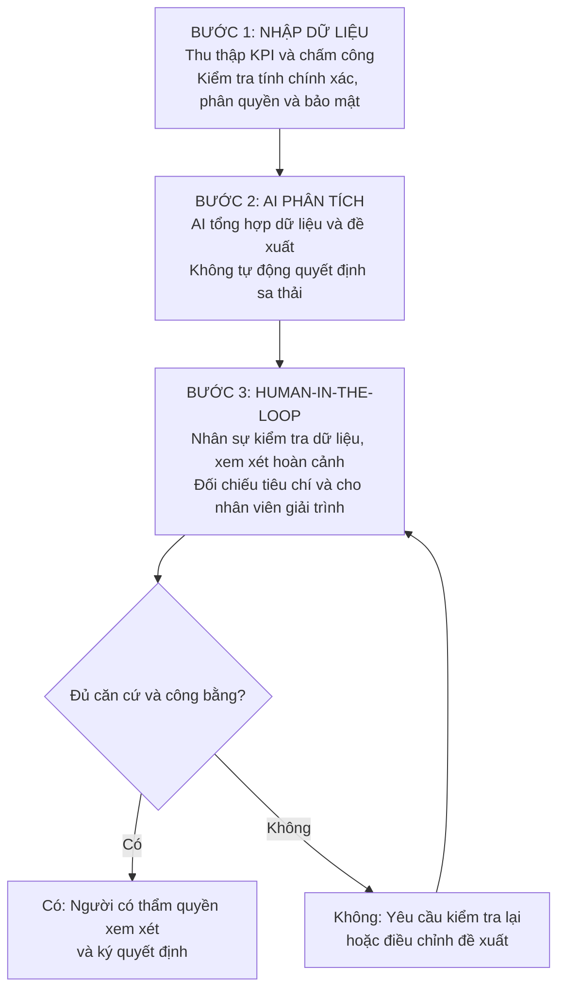

# BÀI LÀM: HUMAN-IN-THE-LOOP TRONG QUY TRÌNH NHÂN SỰ MARTX

## PHẦN 1. PHÂN TÍCH VI PHẠM

Hành động của Trưởng phòng Nhân sự có 2 vi phạm nghiêm trọng:

**Vi phạm 1: Không thực hiện nguyên tắc Human-in-the-loop.**

AI chỉ có vai trò hỗ trợ phân tích và đề xuất (Decision Support), không có quyền tự quyết định việc sa thải nhân viên. Trưởng phòng đã sử dụng kết quả AI mà không kiểm tra, đối chiếu hoặc xác minh lại dữ liệu trước khi ký quyết định. Điều này làm mất vai trò giám sát của con người và có thể dẫn đến quyết định sai ảnh hưởng trực tiếp đến quyền lợi của nhân viên.

**Vi phạm 2: Thiếu trách nhiệm về đạo đức và rủi ro thiên lệch dữ liệu (Bias).**

Dữ liệu KPI và chấm công chưa chắc phản ánh đầy đủ năng lực, hoàn cảnh và hiệu quả làm việc của từng nhân viên. Dữ liệu có thể thiếu, sai hoặc chứa định kiến, khiến AI đánh giá không công bằng. Việc đưa dữ liệu nhân sự lên AI cũng cần tuân thủ quy định về bảo mật và quyền riêng tư.

Trưởng phòng không thể đổ trách nhiệm cho AI. Người có thẩm quyền ký quyết định phải chịu trách nhiệm kiểm tra căn cứ, bảo đảm tính công bằng và tuân thủ quy định của công ty cũng như pháp luật.

## PHẦN 2. SƠ ĐỒ QUY TRÌNH 3 BƯỚC

Quy trình an toàn cho MartX cần có sự kiểm soát của con người trước khi đưa ra quyết định cuối cùng.

**Nguyên tắc thực hiện:** AI chỉ đưa ra đề xuất tham khảo. Bộ phận Nhân sự phải kiểm chứng dữ liệu, đánh giá các yếu tố liên quan và cho nhân viên cơ hội giải trình. Chỉ người có thẩm quyền mới được ký quyết định sau khi đã xem xét đầy đủ căn cứ.
